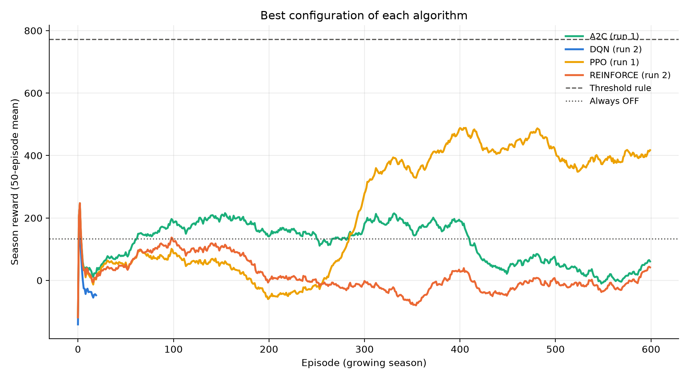
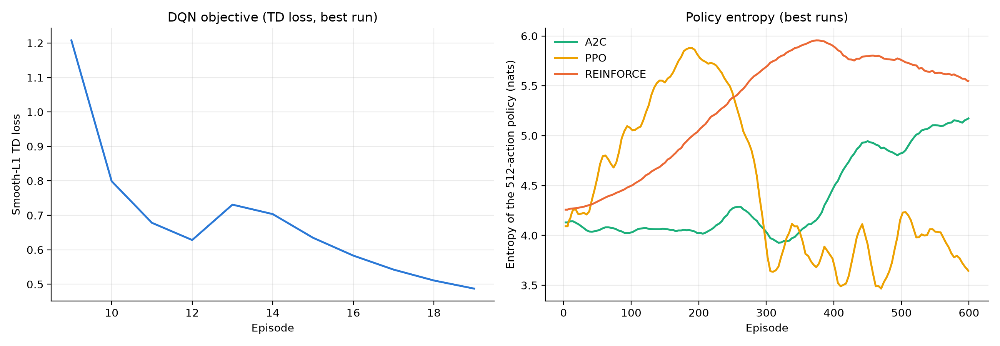
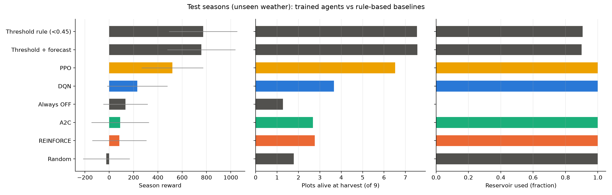
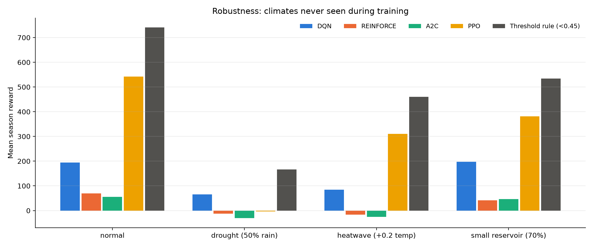

# Reinforcement Learning Summative Assignment Report

**Student Name:** [Favor Ayuk]
**Video Recording:** [Video](https://www.loom.com/share/6f4496661fbe4ab69572d4cd69e90c05)
**GitHub Repository:** [f-Ayuk/Favor_Ayuk-Machine_Learning_Techniques_II-Summative_Assignment](https://github.com/f-Ayuk/Favor_Ayuk-Machine_Learning_Techniques_II-Summative_Assignment.git)

## 1. Project Overview

This project compares DQN, REINFORCE, A2C and PPO on a sequential smart-irrigation task.
The custom simulator models nine crop plots, noisy soil readings, uncertain rain and one shared reservoir.
Each day, an agent chooses which irrigation taps to open, trading water use against future crop health.
The study compares learned policies with simple baselines using held-out seasons and climate stress tests.
In the saved test results PPO leads the RL agents, but the threshold baseline performs best overall.

## 2. Environment Description

The agent represents a farm irrigation controller. It observes the farm once per simulated day and selects a joint setting for nine on/off taps. The simulator updates soil moisture, reservoir volume, crop health and weather; MuJoCo displays this state but does not calculate the water dynamics. The episode starts with full water, healthy crops and moisture sampled from 0.45–0.65. It ends if all crops die or after 120 days. Since each action changes persistent moisture and shared water under uncertain weather, choices have delayed consequences.

### 2.1 Action Space

The Gymnasium wrapper exposes `Discrete(512)`. An action is a nine-bit mask, one bit per plot: bit 0 controls plot 0, through bit 8 for plot 8; `0` closes a tap and `1` opens it. Thus the complete action set is every mask from `000000000` (all taps off) to `111111111` (all on), including every combination between them. Dead plots are not irrigated.

### 2.2 Observation Space

The agent receives a 41-element `float32` vector bounded to [0, 1], refreshed at reset and after every daily step. All values currently come from simulation state; the equipment listed is a possible real-world equivalent, not hardware used in this project.

| Indices | Meaning, encoding and range | Current source and real-world equivalent |
|---|---|---|
| 0–8 | Per-plot soil moisture; float32 fraction [0, 1], with Gaussian noise (standard deviation 0.02). | Simulated moisture plus sensor noise; capacitive soil-moisture probes in a field system. |
| 9–17 | Per-plot crop health; float32 [0, 1], where 0 is dead. | Simulated crop state; camera with crop-health vision or field scouting. |
| 18–26 | Per-plot exposure; float32 [0, 1], normalized from fixed episode factors [0.8, 1.2]. | Sampled simulator parameter; sunlight sensor or calibrated field/soil survey. |
| 27–35 | Current tap states; binary float32 [0, 1]. | Simulated actuator state; valve controller/position telemetry. |
| 36 | Reservoir fraction; float32 [0, 1]. | Simulated remaining volume; tank level sensor. |
| 37 | Next-transition rain forecast probability; float32 [0, 1]. | Simulated weather process; weather-service API or local forecast. |
| 38 | Daily temperature, normalized float32 [0, 1]. | Simulated weather; thermometer or weather API. |
| 39 | Season progress, day/120; float32 [0, 1]. | Simulation clock; controller clock/calendar. |
| 40 | Crop coefficient \(K_c/1.15\); float32 [0, 1]. | Simulated growth-stage rule; crop-stage lookup/model. |

### 2.3 Reward Structure

The objective rewards healthy living crops and penalizes water stress, waterlogging, water use, valve wear and crop loss. For plot \(i\), let \(a_i\) indicate that its tap is open, \(s_i\) and \(w_i\) be its normalized drought and waterlogging stress, \(h_i\) be its healthy-band indicator, \(d_t\) the number of newly dead plots, and \(q_t\) the number of tap switches:

```text
r_t = sum_i alive_i * (healthy_i - 1.5*drought_i - 1.5*waterlog_i)
      - 0.08*sum_i open_tap_i - 0.03*switches_t - 25*new_deaths_t
```

At a completed harvest, the surviving crop-health sum receives a \(10\times\) bonus. The healthy moisture band is [0.45, 0.75]. Open taps add up to 0.07 moisture and use 0.011 reservoir units each per day; if water is insufficient, it is shared among open taps. Moisture also changes through rain, evapotranspiration and drainage. This makes the reward reflect both immediate crop conditions and longer-term water allocation.

## 3. System Analysis and Design

### 3.1 DQN

All agents use the same 41-value input, 512-action interface and default plot-sharing action head. For each plot, a shared two-hidden-layer tanh MLP (128 units per layer) scores its local moisture, health, exposure and tap state together with five farm-wide features. A second small MLP supplies a shared action bias. The 512 action values use `Q(s,a)=b(s)+sum_i a_i*q_i(s)`, a structured alternative to 512 unrelated outputs; flat and factored alternatives are also implemented.

DQN uses a TorchRL Q-value actor, Adam (default learning rate 1e-3), gamma 0.99, a 50,000-transition replay buffer and batch size 64. Double-DQN smooth-L1 loss, a delayed target network updated every 500 steps, and gradient clipping at 10 are enabled by default. Epsilon-greedy exploration decays from 1.0 to 0.05 over 20,000 steps. Training begins after 1,000 transitions, and rewards are scaled by 0.1.

### 3.2 Policy-Gradient Methods: REINFORCE, A2C and PPO

These agents use the same structured head to produce logits for a categorical 512-action policy, plus a two-hidden-layer, 256-unit tanh critic. REINFORCE uses discounted Monte Carlo returns and the default learned value baseline. A2C uses a critic, generalized advantage estimation (GAE) and an entropy term. PPO uses GAE, normalized advantages and a clipped policy objective, with multiple shuffled minibatch epochs. Defaults are Adam learning rate 3e-4, gamma 0.99, GAE lambda 0.95 and entropy coefficient 0.01; PPO additionally uses clip epsilon 0.2, four epochs and minibatches of 256. Policy-gradient agents sample actions during evaluation, so a single replay may vary.

## 4. Implementation and Hyperparameter Experiments

The code defines ten configurations per algorithm, with a common intended protocol of 600 training seasons, shared training seeds, 20 validation seasons and 50 held-out test seasons. The saved `logs/hyperparameter_results.csv` contains only configurations 1 and 2 for each method. In the tables, “—” means no saved validation result, not a zero reward. The recorded validation means below use 20 seasons and are descriptive only.

### 4.1 DQN

| Run | Learning rate | Gamma | Replay (capacity/batch) | Exploration or other change | Val. mean reward |
|---:|---:|---:|---:|---|---:|
| 1 | 1e-3 | 0.99 | 50k / 64 | Epsilon 1 to 0.05/20k; target 500; Double DQN | 29.7 |
| 2 | 3e-4 | 0.99 | 50k / 64 | Default exploration/target | 103.3 |
| 3 | 3e-3 | 0.99 | 50k / 64 | Higher learning rate | — |
| 4 | 1e-3 | 0.95 | 50k / 64 | Lower discount | — |
| 5 | 1e-3 | 0.99 | 100k / 128 | Larger replay and batch | — |
| 6 | 1e-3 | 0.99 | 50k / 64 | Target update every 100 steps | — |
| 7 | 1e-3 | 0.99 | 50k / 64 | Target update every 2,000 steps | — |
| 8 | 1e-3 | 0.99 | 50k / 64 | Epsilon 1 to 0.02/50k | — |
| 9 | 1e-3 | 0.99 | 50k / 64 | Double DQN disabled | — |
| 10 | 1e-3 | 0.99 | 50k / 64 | Flat 512-output head | — |

### 4.2 REINFORCE

| Run | Learning rate | Gamma | Configuration change | Val. mean reward |
|---:|---:|---:|---|---:|
| 1 | 3e-4 | 0.99 | Default; value baseline, 4 episodes/batch | 26.7 |
| 2 | 1e-4 | 0.99 | Lower learning rate | 35.1 |
| 3 | 1e-3 | 0.99 | Higher learning rate | — |
| 4 | 3e-4 | 0.95 | Lower discount | — |
| 5 | 3e-4 | 0.999 | Higher discount | — |
| 6 | 3e-4 | 0.99 | No value baseline | — |
| 7 | 3e-4 | 0.99 | 1 episode/batch | — |
| 8 | 3e-4 | 0.99 | 8 episodes/batch | — |
| 9 | 3e-4 | 0.99 | 64-unit hidden layers | — |
| 10 | 3e-4 | 0.99 | Factored action head | — |

### 4.3 A2C

| Run | Learning rate | Gamma | GAE lambda | Entropy/other change | Val. mean reward |
|---:|---:|---:|---:|---|---:|
| 1 | 3e-4 | 0.99 | 0.95 | Entropy 0.01; default | 56.7 |
| 2 | 1e-4 | 0.99 | 0.95 | Lower learning rate | 45.5 |
| 3 | 1e-3 | 0.99 | 0.95 | Higher learning rate | — |
| 4 | 3e-4 | 0.95 | 0.95 | Lower discount | — |
| 5 | 3e-4 | 0.99 | 0.80 | Lower GAE lambda | — |
| 6 | 3e-4 | 0.99 | 1.00 | Higher GAE lambda | — |
| 7 | 3e-4 | 0.99 | 0.95 | Entropy 0 | — |
| 8 | 3e-4 | 0.99 | 0.95 | Entropy 0.05 | — |
| 9 | 3e-4 | 0.99 | 0.95 | Critic 1.0; 8 episodes/batch | — |
| 10 | 3e-4 | 0.99 | 0.95 | Factored action head | — |

### 4.4 PPO

| Run | Learning rate | Gamma | Clip epsilon | Other change | Val. mean reward |
|---:|---:|---:|---:|---|---:|
| 1 | 3e-4 | 0.99 | 0.2 | Default GAE/entropy/epochs | 80.1 |
| 2 | 1e-4 | 0.99 | 0.2 | Lower learning rate | 26.7 |
| 3 | 1e-3 | 0.99 | 0.2 | Higher learning rate | — |
| 4 | 3e-4 | 0.95 | 0.2 | Lower discount | — |
| 5 | 3e-4 | 0.99 | 0.1 | Narrower clipping | — |
| 6 | 3e-4 | 0.99 | 0.3 | Wider clipping | — |
| 7 | 3e-4 | 0.99 | 0.2 | 10 update epochs | — |
| 8 | 3e-4 | 0.99 | 0.2 | Entropy 0 | — |
| 9 | 3e-4 | 0.99 | 0.2 | 8 episodes/batch; minibatch 512 | — |
| 10 | 3e-4 | 0.99 | 0.2 | Factored action head | — |

Only the first two configurations in each table have saved validation results. Those eight records are too few to establish the effects of the unrecorded settings or to support a completed 40-run comparison.

## 5. Results Discussion

### 5.1 Cumulative Rewards and Training Stability

**Figure 1.** Rolling 50-episode reward for the best saved run per method; dotted lines show held-out baseline means.

{ width=5.8in }

PPO's selected trace rises after roughly episode 280 to rolling rewards around 400–500, but remains variable. A2C improves earlier and declines after about episode 410; REINFORCE fluctuates around zero late in training. The DQN selected trace ends after 20 episodes, unlike the 600-episode policy-gradient histories, so the plot does not support a fair stability or convergence ranking.

**Figure 2.** DQN smooth-L1 temporal-difference loss and policy-gradient entropy.

{ width=5.8in }

DQN loss falls from about 1.2 to 0.5 in its short recorded history; lower loss alone does not establish a good policy. REINFORCE entropy rises toward 6 nats and remains high, A2C entropy increases later, and PPO entropy declines after a mid-training peak and fluctuates near 3.5–4.2 nats late in training. These curves describe exploration and optimization, not held-out reward or convergence.

### 5.2 Episodes to Converge

The saved artifacts do not provide a defensible episodes-to-convergence comparison. Selected DQN history has 20 episodes; the selected policy-gradient histories have 600, and the curves do not show stable plateaus consistently. The training code's heuristic convergence field is not treated as evidence of stable performance. More common-length runs and repeated seeds are required to estimate convergence.

### 5.3 Generalization to Unseen Seasons

The following results are means over 50 held-out seasons; reward is mean ± sample standard deviation. “Full season” is the fraction reaching day 120. The policies were tested on the same ordered seed set.

| Policy | Reward | Alive / 9 | Full season | Time in band | Water used |
|---|---:|---:|---:|---:|---:|
| DQN | 231.5 ± 248.4 | 3.66 | 0.70 | 0.439 | 1.000 |
| REINFORCE | 82.4 ± 223.1 | 2.76 | 0.66 | 0.355 | 1.000 |
| A2C | 89.8 ± 236.4 | 2.68 | 0.68 | 0.355 | 1.000 |
| PPO | **519.6 ± 254.1** | 6.52 | 0.94 | 0.558 | 1.000 |
| Threshold (<0.45) | **772.2 ± 281.6** | 7.54 | 0.94 | 0.731 | 0.906 |
| Threshold + forecast | 758.3 ± 280.2 | 7.56 | 0.94 | 0.717 | 0.900 |
| Always OFF | 133.0 ± 182.9 | 1.28 | 0.52 | 0.432 | 0.000 |
| Random | −23.8 ± 192.3 | 1.78 | 0.52 | 0.320 | 1.000 |

**Figure 3.** Held-out reward and crop/water outcomes across the saved policies.

{ width=5.8in }

PPO is the strongest saved RL method, with 6.52 plots alive on average and a 94% full-season rate. The threshold rule exceeds PPO by 252.6 mean reward, reaches the same full-season rate, leaves more plots alive and uses less water. Rewards are variable; the paired DQN-minus-threshold mean difference is −540.7 (approximate paired 95% t-interval: [−602.1, −479.2]). These comparisons describe the saved checkpoints, not a completed sweep.

Stress tests use 25 seasons per policy and scenario:

| Scenario | DQN | REINFORCE | A2C | PPO | Threshold |
|---|---:|---:|---:|---:|---:|
| Normal | 194.6 | 69.1 | 55.7 | 542.5 | **740.8** |
| 50% rain | 65.3 | −12.0 | −30.7 | −3.2 | **166.9** |
| +0.2 temperature | 84.5 | −16.5 | −25.4 | 310.1 | **460.3** |
| 70% reservoir | 197.5 | 41.0 | 46.5 | 381.4 | **533.9** |

**Figure 4.** Mean reward under held-out climate and reservoir changes.

{ width=5.8in }

The threshold rule leads in every scenario. PPO is the strongest learned method in normal, heatwave and reduced-reservoir tests; DQN leads learned methods in the 50%-rain test, where all policies have zero surviving plots and no full-season completions. This is limited evidence of transfer, not proof of robust real-world performance.

## 6. Conclusion and Discussion

On the current saved 50-season test, PPO is the best-performing RL agent, while the simple moisture-threshold rule performs best overall. PPO learns a useful policy but has lower reward, fewer surviving plots and greater water use than the threshold rule. DQN's short trace, the variability in returns, and the two recorded configurations per algorithm limit claims about convergence and hyperparameter effects. A complete, consistently saved ten-configuration sweep with repeated seeds and longer DQN histories is the main improvement needed. The simulator is a simplified water-balance model, not a validated crop model; results are not agronomic advice.

## References

- Mnih et al. (2015). Human-level control through deep reinforcement learning. *Nature*, 518, 529–533.
- Williams (1992). Simple statistical gradient-following algorithms for connectionist reinforcement learning. *Machine Learning*, 8, 229–256.
- Schulman et al. (2016). High-dimensional continuous control using generalized advantage estimation. *ICLR*.
- Schulman et al. (2017). Proximal policy optimization algorithms. arXiv:1707.06347.
